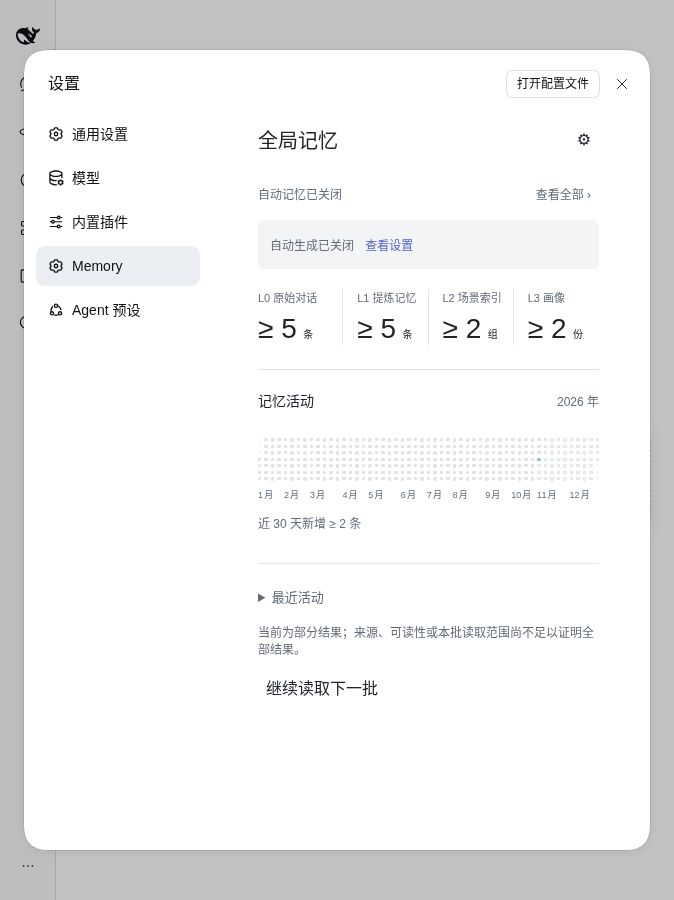
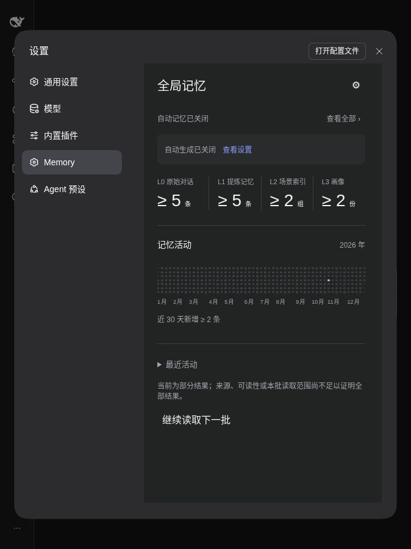

# DSH Memory TDAI · 全局记忆

基于 [TencentDB Agent Memory](https://github.com/TencentCloud/TencentDB-Agent-Memory) 思路二次开发的 DeepSeek Harness 记忆插件。采用 MIT 许可证，非腾讯官方产品，无腾讯背书。

[桌面与插件总入口](https://github.com/Missher12/Missher-DeepseekHarness-Desktop) · [下载与版本记录](https://github.com/Missher12/Missher-DSH-Memory-TDAI/releases) · [技术参考](docs/technical-reference.md) · [本次验证记录](verification/2026-10-29-0.1.1-acceptance.md)

## 它能帮你做什么

换一个会话后，仍能检索同一 DSH profile 中已经保存、允许使用的事实与偏好。项目和会话用来说明记忆来自哪里；普通使用入口统一查看全局记忆，不需要手动切换项目范围。不同 profile 的数据保持隔离。

插件先保留来源，再提炼事实，按需检索相关片段。它不是把所有历史原文塞进每次请求，也不是无限扩充模型上下文。搜索与界面统计只读取本地数据；自动提炼可能调用你配置的宿主模型并产生费用。

## 实际界面

以下图片来自真实的官方 DSH `0.2.1-rc.4` Web 设置页，使用**合成验收数据**；图中的数量不是用户真实记忆容量或节省 Token 的宣传数据。





## 四层记忆如何工作

| 层级 | 保存什么 | 用途 |
| --- | --- | --- |
| L0 原始对话 | 可追溯的对话来源 | 查看原始证据，帮助后续提炼 |
| L1 提炼记忆 | 从来源中提取的事实与偏好 | 搜索、查看详情，并遗忘不再需要的内容 |
| L2 场景索引 | 对相关记忆的组织与关联 | 更容易找到某类任务或场景的线索 |
| L3 画像 | 基于可读取来源形成的摘要 | 在有证据的基础上组织长期偏好 |

高置信度、有来源且无显式冲突的自动提炼结果可以投入使用；不确定或冲突内容保留候选状态。遗忘会使相关记忆及派生引用失效，重试不应把它重新复活。

## 能记住多少、能省多少 Token

插件不设每日 Token／任务次数配额，也不设累计记忆条数配额。旧配置中的每日配额（包括 0）不再阻断提炼或画像请求。实际容量仍取决于本地磁盘与基础设施，不承诺物理容量无限。

召回不会因为超过 250ms 而整包丢弃；仍按相关性选择内容，保留单次分页、候选和上下文大小控制，部分结果会明确标注。身份、来源权限、当前修订和最终发布证明仍须通过。默认 `retention.days=0` 不自动清理 L0；用户明确设置的保留期、删除和遗忘仍生效。

提炼与画像保留单活动请求防重、真实用量记录和未知调用保护，不会因取消配额自动重试未知请求。显式关闭生成、使用、采集或提炼的设置仍有效。账户额度和提供方限制由相应服务控制。没有统一的 Token 节省百分比，效果取决于检索相关性和模型能力。

节省输入的方式是只检索、注入有用的短片段，避免重复携带全部历史。提炼本身也会花费模型 Token，因此应比较“提炼成本 + 召回输入成本”和原来的历史输入成本，再判断实际收益。

当前页面保留诚实的计数边界：`≥` 表示已知下界，部分结果不当作全库精确计数。年度活动图统计记忆首次修订及后续内容／证据修订，不把每次打开页面或召回都算成新增记忆。需要时点击“继续读取下一批”。

## 两个独立开关

在 DSH **设置 → Memory** 中点击齿轮：

- **自动生成记忆**：控制新的采集与提炼。关闭后保留已有记录，但停止新生成，并阻止在途旧结果重新生效。
- **在对话中使用记忆**：控制后续对话的记忆注入和读取工具。关闭后仍可以在设置页查看已有记录。

开关独立保存，失败会显示明确状态；重试提交原来失败的设置，并回读确认。支持浅色／深色主题、搜索、详情、来源、四层浏览和年度活动图。

## 当前交付与兼容范围

2026-10-29：正常版本线 `0.1.1` 已完成源码、构建和受影响验证，使用同一套插件源码、配置与完整安装包。取消每日 Token／任务次数配额，修复跨会话首次召回、无命中分页及关闭生成时的在途结果处理；原有数据隔离、权限、删除与来源校验继续生效。

本次在官方 `0.2.1-rc.4` Web 宿主完成 7 项实际界面验收：320／390 内容宽度的明暗主题、同工作区新会话首次召回、关闭生成的保存回执与读回，以及最后的无额外模型调用检查。活动图保留 371 个格位（365 天与 6 个补位），查看详情和切换设置时布局保持稳定。247 项测试是复用未变结果与本轮定向验证合并的覆盖，并非同一轮全部重跑。

通过[版本下载页](https://github.com/Missher12/Missher-DSH-Memory-TDAI/releases)获取正常完整插件包及 SHA256SUMS。`v0.1.1` 的发布和本机安装由交付步骤接续；旧 `v0.1.0-local.2` 保留供回滚。官方 Web 验收不等于各系统 Electron 原生设置页都已验收，也不代表真实商业模型质量或整个账户的用量证明。

兼容通过公开能力探测和明确降级实现，目标覆盖旧版与新版，不按桌面／官方／社区拆包。依赖范围见 `package.json`；已测版本是证据，不是对未测版本的保证。插件市场搜索需要独立上架，公开 Git 和 Release 不等于已经上架。

## 从源码构建

需要满足 `package.json` 声明的 Node.js 与依赖版本。

```sh
git clone https://github.com/Missher12/Missher-DSH-Memory-TDAI.git
cd Missher-DSH-Memory-TDAI
npm ci
npm run build
npm pack
```

通过 DSH 的插件管理器安装生成的 bundle（`install_bundle`）。不要直接改日常 profile 的 `package.json` 或 `cordis.patch.yml`。本仓库的 `private: true` 用于避免误发 npm，不影响 GitHub 源码的公开与 MIT 授权。

开发者需要检查时可运行 `npm run typecheck` 和 `npm test`；这些命令会消耗本机资源。本次交付复用了字节未变的通过证据，没有重复运行整套平台矩阵。

## 数据与边界

数据默认位于 `$DSH_HOME/memory-tdai/`，项目分片保留来源信息，同一 profile 的普通召回使用全局视图。没有在此版本中承诺跨设备自动同步。

- 历史记忆是参考数据，不是新的操作授权或系统指令。
- 浏览页面和检索统计不应额外调用模型；自动生成按配置使用宿主模型。
- 卸载插件不等于删除记忆数据。迁移设备前请单独备份 profile 数据。
- 向量后端、真实商业模型效果和各操作系统的当前安装效果，应以相应验证记录为准。

上游贡献与许可证详见 [THIRD_PARTY_NOTICES.md](THIRD_PARTY_NOTICES.md) 和 [LICENSE](LICENSE)。
